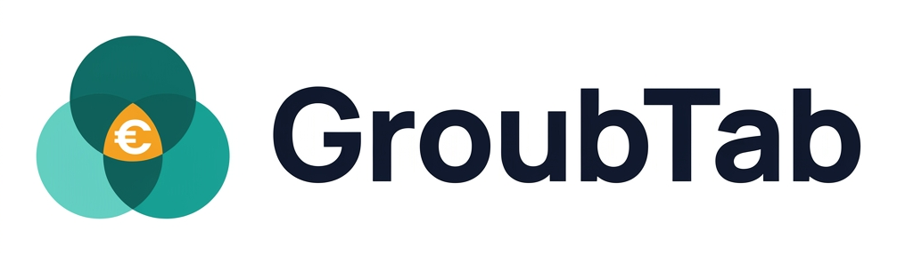

<p align="center">
  <a href="README.md">Español</a> | <b>English</b>
</p>

<h1 align="center">
  <picture>
    <source media="(prefers-color-scheme: dark)" srcset="assets/branding/groubtab-logo-dark.png">
    
  </picture>
</h1>

<p align="center">
  Web platform for smart shared-expense management with automatic receipt scanning using AI.
</p>

<p align="center">
  <a href="LICENSE"></a>
</p>

## About

GroubTab lets groups of people manage and plan shared expenses: friends, flatmates, trips… Each user has an account, creates groups and adds expenses, and always knows what is pending, what is settled and who owes whom. Receipts are read automatically using AI, so there is no need to enter every expense by hand.

Final Year Project of the Higher Vocational Diploma in Web Application Development (DAW) · Centro San Valero.

## Brand identity

### Name and logo rationale

**GroubTab** is the name of the web platform for managing shared expenses and tracking balances within a group. It combines the idea of a group (**"Groub"**) with that of a shared tab (**"Tab"**).

Its visual identity uses overlapping circles in teal and mint tones, representing the union of the participants. The central orange accent, with the euro symbol (€), symbolizes the common point where the group's expenses come together and are balanced.

### Color palette

| Color | HEX | Usage |
|---|---|---|
| Navy | `#0F172A` | Dark backgrounds and main text |
| Deep Teal | `#0D6C66` | Main brand color |
| Teal | `#169E92` | Secondary elements and active states |
| Mint | `#5FCFC1` | Soft backgrounds and details |
| Amber | `#F2A121` | Accent color: amounts and calls to action |
| White | `#FFFFFF` | Surfaces and cards |

## Structure

```
groubtab/
├── .github/            # PR template, CODEOWNERS and workflows
├── assets/branding/    # Logo and icon
├── CONTRIBUTING.md     # Contribution guide (Spanish)
├── CONTRIBUTING.en.md  # Contribution guide (English)
├── LICENSE
├── README.md
└── README.en.md
```

## Contributing

The team's working rules (branches, commits and Pull Requests) are in the [contribution guide](CONTRIBUTING.en.md).

## Notice

The availability of the name GroubTab has not been checked in trademark registries (OEPM, EUIPO). The logo was created with the help of AI.

## Authors

Pablo Ubieto Foncillas ([@PabloUbieto](https://github.com/PabloUbieto)) and Álvaro López Martínez ([@alvaaroms](https://github.com/alvaaroms)).

## License

This project is released under the [MIT license](LICENSE).

---

<p align="center">
  2nd year DAW · Centro San Valero · Academic year 2026/2027
</p>
