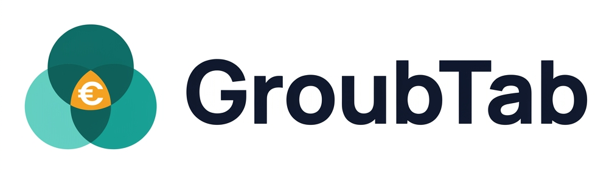

<p align="center">
  <b>Español</b> | <a href="README.en.md">English</a>
</p>

<h1 align="center">
  <picture>
    <source media="(prefers-color-scheme: dark)" srcset="assets/branding/groubtab-logo-dark.png">
    
  </picture>
</h1>

<p align="center">
  Plataforma web para la gestión inteligente de gastos compartidos con lectura automática de tickets mediante IA.
</p>

<p align="center">
  <a href="LICENSE"></a>
</p>

## Descripción

GroubTab permite gestionar y planificar gastos compartidos entre grupos de personas: amigos, compañeros de piso, viajes… Cada usuario tiene su cuenta, crea grupos y añade gastos, y en todo momento sabe qué está pendiente, qué está saldado y quién debe pagar a quién. Los tickets se leen automáticamente mediante IA para no tener que introducir cada gasto a mano.

Proyecto Final de Ciclo del Grado Superior en Desarrollo de Aplicaciones Web (DAW) · Centro San Valero.

## Identidad de marca

### Justificación del nombre y el logotipo

**GroubTab** es el nombre de la plataforma web para la gestión de gastos compartidos y el control de saldos en grupo. Combina la idea de grupo (**«Groub»**) con la de cuenta compartida (**«Tab»**).

Su identidad visual usa círculos superpuestos en tonos verde azulado y menta, que representan la unión de los participantes. El acento naranja central, con el símbolo del euro (€), simboliza el punto común donde se concentran y equilibran los gastos del grupo.

### Paleta de color

| Color | HEX | Uso |
|---|---|---|
| Navy | `#0F172A` | Fondos oscuros y texto principal |
| Deep Teal | `#0D6C66` | Color principal de la marca |
| Teal | `#169E92` | Elementos secundarios y estados activos |
| Mint | `#5FCFC1` | Fondos suaves y detalles |
| Amber | `#F2A121` | Color de acento: importes y llamadas a la acción |
| White | `#FFFFFF` | Superficies y tarjetas |

## Estructura

```
groubtab/
├── .github/            # Plantilla de PR, CODEOWNERS y workflows
├── assets/branding/    # Logotipo e icono
├── CONTRIBUTING.md     # Guía de contribución (español)
├── CONTRIBUTING.en.md  # Guía de contribución (inglés)
├── LICENSE
├── README.md
└── README.en.md
```

## Contribuir

Las normas de trabajo del equipo (ramas, commits y Pull Requests) están en la [guía de contribución](CONTRIBUTING.md).

## Aviso

No se ha verificado la disponibilidad del nombre GroubTab en los registros de marcas (OEPM, EUIPO). El logotipo se ha creado con ayuda de IA.

## Autores

Pablo Ubieto Foncillas ([@PabloUbieto](https://github.com/PabloUbieto)) y Álvaro López Martínez ([@alvaaroms](https://github.com/alvaaroms)).

## Licencia

Este proyecto se publica bajo la [licencia MIT](LICENSE).

---

<p align="center">
  2º DAW · Centro San Valero · Curso 2026/2027
</p>
